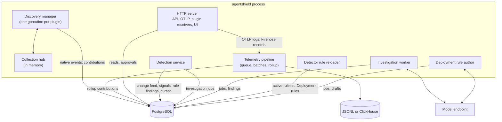

This page maps the runtime: what runs inside the `agentshield` process, how data moves between components, and which page owns each subsystem. The end-to-end pipeline diagram is in [What AgentShield does](/docs/concepts/overview/#pipeline). Terms are defined in the [glossary](/docs/concepts/glossary/).

## One process, one database

`cmd/agentshield` is a single binary. It needs PostgreSQL and, optionally, ClickHouse and a model endpoint. At startup it:

1. Registers the identity schemes declared by the compiled-in plugin descriptors. Today only Kubernetes and AWS declare schemes; Istio, agentgateway, Cilium, and Falco reuse the Kubernetes scheme. Schemes are registered even for plugins that are not enabled, so contributions stored by earlier runs still compile.
2. Opens PostgreSQL and applies any pending migrations, within 5 minutes (see [Publication and storage](/docs/architecture/publication-and-storage/#schema-migrations)). The remaining startup steps that call external services share a 30-second budget.
3. Builds the discovery plugins:
   - `aws`, if `--aws-region` is set.
   - `kubernetes`, `istio`, `agentgateway`, `cilium`, and `falco`, unless `--kubernetes-disable` is set.
   - None, if `--disable-discovery` is set. The process then only serves what is already stored.
4. Opens the raw telemetry sink (JSONL by default, ClickHouse with `--clickhouse-url`) and restores telemetry rollups from the current graph.
5. Builds the HTTP API. Live remediation is enabled only when discovery is running and `--listen` is a loopback address.
6. If `--agentic-investigation` or `--deployment-rule-authoring` is set, loads detection rules and starts the detection service, plus the investigation worker and the Deployment rule-authoring worker for whichever features are enabled.

Then it runs these loops concurrently until it receives SIGINT or SIGTERM. If any loop fails, the process shuts down.

The detection service and detector reloader run when `--agentic-investigation` or `--deployment-rule-authoring` is set; the investigation worker and the rule author run only for their own flag. The detection service never calls a model. `--model-provider=anthropic` applies only to the rule author (see [Change feed and reasoning](/docs/architecture/change-feed-and-reasoning/#detection-and-investigation)).

## How data moves

1. **Discovery.** Each plugin runs in its own goroutine under `discovery.Manager`. Source plugins publish provider objects as changes to named collections through the `Runtime`. `Runtime.Publish` first stores each change as a native event in PostgreSQL, then fans it out through the in-memory collection hub. Semantic plugins subscribe to those collections. Every plugin runs its projector and calls `ReplaceContribution` with its complete output. See [Plugins](/docs/plugins/contract/).
2. **Publication.** `ReplaceContribution` validates and stores the contribution, updates the current graph tables, and appends a change-feed row, all in one transaction. See [Publication and storage](/docs/architecture/publication-and-storage/).
3. **Telemetry.** The OTLP receiver (`POST /v1/logs`) and plugin-registered native receivers turn records into normalized events. The pipeline writes each batch to the raw sink, then updates per-minute rollups and publishes them under provider ownership. Events without a provider mapping are discarded instead of receiving a synthetic host owner. See [Telemetry](/docs/architecture/telemetry/).
4. **Detection and investigation.** The detection service polls the change feed, builds the graph before and after each change window, and runs detectors. Active rule matches become findings directly; eligible novelty signals are queued for the investigation worker, which samples them, asks the model to investigate, and records validated results as findings. See [Change feed and reasoning](/docs/architecture/change-feed-and-reasoning/) and [Detection rules](/docs/architecture/detection-rules/).
5. **Remediation.** A user picks a suggested remediation in the UI, prepares it (plan and dry-run), and approves it. Only then does the selected plugin write to the provider. See [Remediation](/docs/architecture/remediation/).

Some things never flow backwards. Findings and remediation state are never published as graph contributions or collection changes, so reasoning cannot trigger itself, and there is no command channel from the graph to discovery.

## Plugin wiring

`cmd/agentshield/main.go` wires plugins explicitly; there is no dynamic plugin loading. The Kubernetes plugin is built last because it needs the resource requirements of collection consumers: it collects every `ResourceRequirement` from `istio`, `agentgateway`, and `cilium` (`falco` needs none; it only maps telemetry), and opens one shared informer per unique resource type. The informer client has no request timeout, because client-go applies it to watch streams too; API discovery and remediation actions use a separate client with a 30-second timeout. Both allow 50 requests per second with a burst of 100. Each plugin owns its own prefixed flags, including a `--<plugin>-cluster-id`; use matching authority values when their assertions need to refer to the same Kubernetes objects. Flag registration enforces the plugin prefix and rejects duplicate names.

The manager checks that each `(plugin, source)` pair is registered once, that each collection has one publisher per source, and that every consumed collection has a publisher on the same source. It starts all plugins concurrently, in a deterministic order, and scopes each plugin's runtime to its source ID so two instances cannot read or overwrite each other's collections. A plugin instance that fails or panics is restarted on its own with backoff while the others keep running; see [Errors](/docs/plugins/contract/#errors).

## HTTP surface

The API and OTLP route are served by `pkg/api` on `--listen` (default `127.0.0.1:8088`). Plugins register their own native telemetry routes with the host; AWS supplies the Firehose route.

The [HTTP API reference](/docs/operations/api/) owns the endpoint catalog, request and response details, and event-stream behavior. There is no authentication; see the [security model](/docs/operations/security/).

## Reading the graph

`GET /api/v1/graph` loads the active assertions and compiles them on every request with the same compiler used during publication, so a read always matches the stored assertions. Indexed list and detail endpoints read the current projection tables instead. The neighborhood endpoint currently filters the compiled graph in memory.

## Web UI

The UI is a React app in `ui/`, built with Vite into `ui/dist` and embedded into the binary by `ui/embed.go`. If it was not built, `/` shows a "UI is not built" page and the API still works. The UI only calls same-origin `/api` routes. See [Getting started](/docs/getting-started/run-locally/) and [Testing](/docs/development/testing/#web-ui).

## Failure behavior

Discovery restarts a failed plugin instance on its own (see [Errors](/docs/plugins/contract/#errors)); otherwise the process has no supervisor inside it. The discovery manager, telemetry pipeline, detector rule reloader, detection service, and HTTP server run in one `errgroup`; when any of them returns an error or panics, the others are cancelled and `agentshield` exits non-zero. A panic in one of those top-level goroutines becomes an error carrying its stack; a panic in a goroutine a component starts itself still crashes the process. Shutdown, on a signal or a failure, runs in order: the HTTP server stops accepting requests, closes open `/api/v1/events` streams, and gets 10 seconds for in-flight requests; only then is the telemetry pipeline cancelled, and it drains its queue (see [Telemetry](/docs/architecture/telemetry/#failure-behavior)). Run it under something that restarts it (systemd, a Kubernetes Deployment). The investigation worker and the Deployment rule author report their errors, retry their jobs, and keep running; a model outage never stops the process or detection.

| Failure | Behavior |
| --- | --- |
| PostgreSQL unreachable at startup | Exits before starting anything. There is no connection retry. |
| A plugin's `Run` returns an error or panics (failed required sync, unexpected subscription closure, publication failure) | The manager logs it, republishes that instance's last healthy output as `degraded`, and restarts only that instance with backoff (1 s doubling to 2 min). Other plugins keep running. See [Errors](/docs/plugins/contract/#errors). |
| A subscriber falls behind its collection | Not a failure. The hub coalesces that subscriber's pending changes to the latest per key and logs a warning; publishers never block. See the [tutorial](/docs/plugins/tutorial/#2-receive-observations). |
| A provider becomes unavailable after the first publication | Plugins republish their last good input as `degraded` or stale and keep running. See [Lifecycle](/docs/plugins/contract/#lifecycle). |
| Telemetry sink or graph publication failure | See [Telemetry](/docs/architecture/telemetry/#failure-behavior). |

On restart, plugins recover their generations, the in-memory hub is rebuilt from fresh provider snapshots, and reasoning either continues from its stored cursor or records a rebase (see [Startup and restarts](/docs/architecture/change-feed-and-reasoning/#startup-and-restarts)).

## Known limits

These are the main constraints of the current design:

- **Single writer.** Every publication takes one graph-wide PostgreSQL advisory lock and rebuilds the current projection tables. This keeps the graph coherent but limits write throughput.
- **No history API.** The store keeps what is needed to rebuild old graphs (versions, deltas, checkpoints, manifests), but there is no endpoint that does it yet. Reasoning cannot analyze changes that happened while it was down; it records a rebase instead.
- **In-process state.** Prepared remediations, the collection hub, and the telemetry rollup live in memory in one process. Replicas do not coordinate.
- **No authentication.** See the [security model](/docs/operations/security/).
- **Kubernetes identity includes the requested API version.** Changing the version a plugin watches for a resource type re-keys every object of that type: old resources are retracted and new ones asserted. A CRD storage-version change in the cluster does not do this. See [Kubernetes objects](/docs/concepts/data-model/#kubernetes-objects).
- **Kubernetes Helm chart.** [`deploy/kubernetes`](https://github.com/solo-io/agentshield/blob/main/deploy/kubernetes/README.md) provides a chart with read-only discovery RBAC and configurable storage. The project does not publish a container image yet; configure an image built or hosted by your organization.
